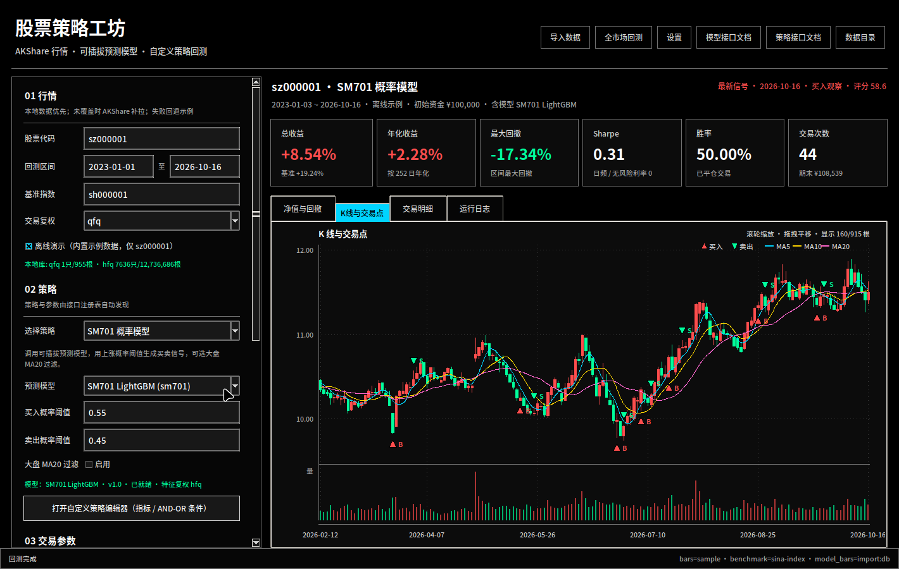
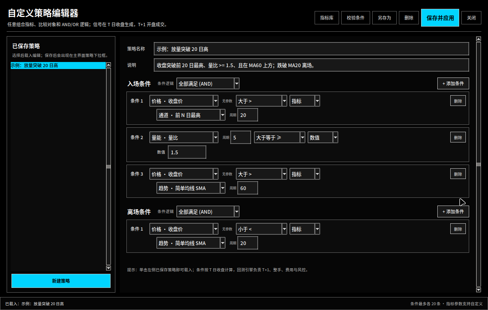
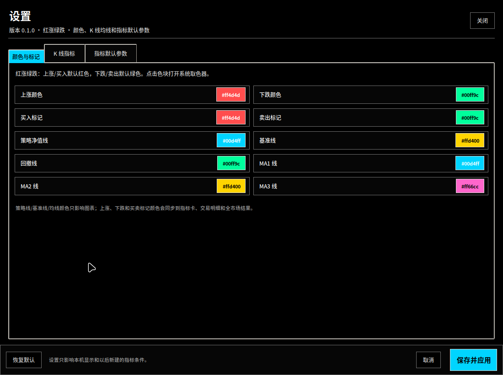
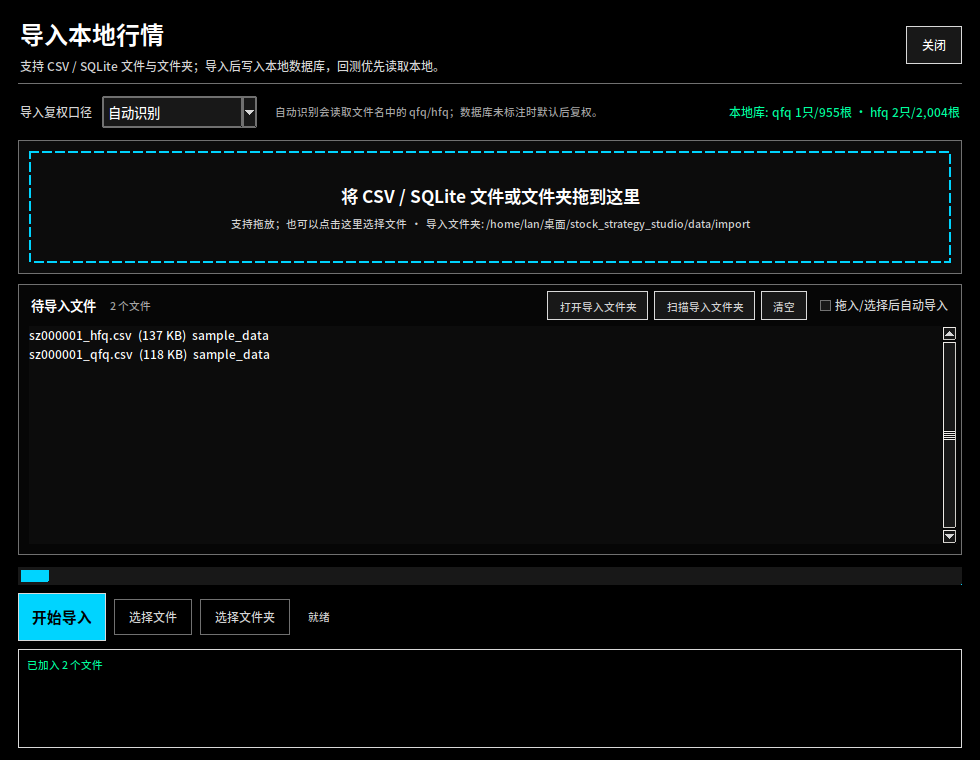
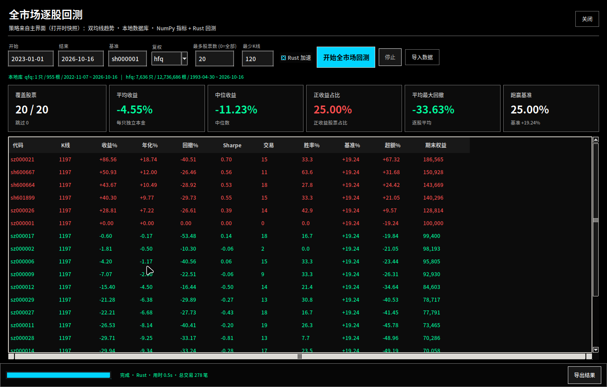

# 股票策略工坊 v0.1.0

> 技术文档：[`docs/TECHNICAL.md`](docs/TECHNICAL.md) · 版本 0.1.0

一个面向 A 股的本地策略研究与回测工具：

- **AKShare 行情**：东方财富 / 腾讯 / 新浪多通道自动回退，SQLite 本地缓存。
- **自定义策略**：程序内条件编辑器，支持 42 个技术指标、双指标比较、AND/OR 组合、保存/编辑/删除。
- **策略扩展**：双均线、通道突破、RSI 示例；也支持放入 `strategies/plugins/*.py` 自动扩展。
- **可接入预测模型**：模型接口 + 自动发现；内置 **SM701 LightGBM** 示例（44 维特征）。
- **高对比 GUI**：纯黑背景、亮青强调色、纯白文字；默认 **红涨绿跌**；参数表单、净值/回撤曲线、K 线交易点、交易明细、日志。
- **K 线交互**：滚轮缩放、拖拽平移、十字光标、成交量、MA/EMA 均线和买卖标记。
- **个性化设置**：上涨/下跌/买卖/策略线/基准线/回撤线/均线颜色，MA/EMA 类型与周期，自定义指标默认参数。
- **全市场逐股回测**：从本地数据库读取全部 A 股，批量回测、汇总统计、排序、导出；每只股票独立本金。
- **本地数据导入**：导入窗口支持直接拖入 CSV / SQLite 文件或文件夹，写入 SQLite 后单股和全市场回测优先读取本地。
- **NumPy + Rust**：指标计算使用 NumPy/Pandas，成交撮合与资金曲线使用 Rust（ctypes）加速，失败自动回退 Python。
- **离线演示**：内置 `sz000001` 的 AKShare 示例行情，可在无网络环境直接跑通。

> 本项目仅用于研究与演示，不构成任何投资建议。



自定义策略编辑器：



个性化设置（颜色与指标参数）：



本地数据导入（支持拖放）：



全市场逐股回测：



---

## 快速开始

### 桌面启动

双击桌面上的「股票策略工坊」图标，或运行（默认选中 SM701 概率模型示例）：

```bash
cd ~/桌面/stock_strategy_studio
./launch.sh
```

首次启动会自动使用 `.venv`（如果不存在会创建，并复用系统已安装的依赖）。
依赖见 `requirements.txt`：

```bash
.venv/bin/python -m pip install -r requirements.txt
```

系统要求：
- Python 3.10+
- Tkinter
- `akshare`、`pandas`、`numpy`、`lightgbm`、`tkinterdnd2`（拖拽导入）
- Rust（可选，用于回测加速；未安装时自动回退 Python）

### 命令行

```bash
# 查看策略 / 模型
.venv/bin/python cli.py --list-strategies
.venv/bin/python cli.py --list-models

# 离线回测 SM701（使用内置示例行情）
.venv/bin/python cli.py --symbol sz000001 --strategy sm701 \
  --start 2023-01-01 --end 2026-10-16 --offline

# 在线 AKShare 行情 + 双均线
.venv/bin/python cli.py --symbol sz000001 --strategy dual_ma \
  --start 2023-01-01 --end 2026-10-16

# 导出完整报告
.venv/bin/python cli.py --symbol sz000001 --strategy breakout \
  --start 2023-01-01 --end 2026-10-16 --offline --export exports
```

---

## 界面说明

1. **行情**：输入 6 位代码或带前缀代码（`sz000001`、`sh600519`），选择回测区间、基准指数和复权口径。
   - 勾选「离线演示」时不访问网络，只使用本地缓存和内置示例。
   - 未勾选时：本地缓存覆盖请求区间则直接使用；未覆盖时访问 AKShare 补拉；失败回退示例（仅 `sz000001`）。
2. **策略**：选择内置、插件或自定义条件策略，参数表单由接口定义自动生成。
   - 「SM701 概率模型」会显示模型加载状态和特征复权口径。
   - 点击「打开自定义策略编辑器」可创建、编辑、删除自定义策略。
3. **交易参数**：初始资金、佣金、印花税、滑点、仓位、止损、止盈、最长持有、期末清仓。
4. **开始回测**：后台线程执行，不阻塞界面。
5. **结果**：
   - 总收益、年化、最大回撤、Sharpe、胜率、交易次数；
   - 策略净值 vs 基准曲线、回撤区域；
   - **K 线与交易点**：滚轮缩放、按住左键拖拽平移、悬浮显示 OHLC/涨跌/成交量；
   - 每笔交易的净盈亏、费用、持有天数和原因；
   - 可导出 CSV/JSON/Markdown 报告。
6. **左侧栏**：鼠标悬停在左侧任意位置即可滚轮滚动；窗口较小时无需拖拽滚动条。
7. **顶部按钮**：「导入数据」打开本地行情导入窗口；「全市场回测」使用主界面当前策略、参数和交易设置扫描本地全部 A 股；「设置」打开颜色和指标参数面板。

---

## 红涨绿跌与个性化设置

默认遵循 A 股习惯：**上涨/买入为红色，下跌/卖出为绿色**。

点击顶部「设置」：

- **颜色与标记**：上涨、下跌、买入标记、卖出标记、策略净值线、基准线、回撤线、MA1/MA2/MA3 颜色。
- **K 线指标**：均线类型（MA/EMA）、三条均线周期。
- **指标默认参数**：SMA、EMA、RSI、MACD、KDJ、BOLL、ATR、量比、BIAS 的默认参数；用于自定义策略编辑器新建条件时预填。
- 保存后立即重绘当前图表，并更新指标卡、交易明细和全市场结果的红绿颜色。
- 设置保存到 `config/settings.json`（本机配置，不纳入仓库）。
- 「恢复默认」可回到红涨绿跌、MA5/10/20 和标准指标参数。

---

## 本地数据导入与优先读取

点击顶部「导入数据」：

- 弹窗内有拖放区，直接把 **CSV / SQLite 文件或文件夹** 拖进去；默认拖入/选择后自动导入，可关闭该选项。
- 也支持「选择文件」「选择文件夹」「打开导入文件夹」「扫描导入文件夹」。
- 导入复权口径可选择：自动识别、前复权 qfq、后复权 hfq、不复权。
- 支持多股票长表（含 `symbol/code/股票代码` 列）和单股票文件（从文件名识别代码，如 `sz000001_qfq.csv`）。
- CSV 日期支持 `YYYY-MM-DD` 和 `YYYYMMDD`；中英文列名均可。
- SQLite 支持本项目 `bars` 表，也支持 `daily_bars(code,date,open,high,low,close,vol)` 等常见表。
- 导入写入 `data/cache.db`；单股回测在本地缓存覆盖请求区间时**优先读取本地**，全市场回测只读取本地数据库。
- 导入文件夹：`data/import/`，也可以从外部拖入后点「扫描导入文件夹」。

> 全市场回测需要足够的历史数据。默认要求每只股票在预热期 + 回测区间内至少 120 根 K 线。
>
> 更完整的字段说明见 [`docs/DATA_IMPORT.md`](docs/DATA_IMPORT.md)。

---

## 全市场逐股回测

顶部「全市场回测」会弹出独立窗口：

- 使用主界面当前策略、策略参数、初始资金、费用、滑点、止损止盈等设置。
- 输入回测区间、基准、复权口径、最多股票数（0=全部）、最少 K 线。
- 只从本地数据库读取 A 股（自动排除指数、ETF 等非股票代码）。
- 每只股票使用独立初始资金，按同样的 T+1 / 整手 / 费用规则逐股回测。
- 汇总覆盖数量、平均/中位收益、正收益占比、平均回撤、跑赢基准比例。
- 表格支持按列排序，可导出 `stocks.csv`、`summary.json`、`report.md`。
- 支持中途停止；结束后显示 Rust/Python 引擎、总交易笔数和耗时。

> 这是「逐股独立回测」：适合评估策略在全市场的泛化表现，不是多股票资金组合回测。组合级回测可在后续版本扩展。

---

## NumPy 与 Rust 加速

- NumPy 已安装并用于指标与回测矩阵计算；Pandas 负责行情整理和特征。
- Rust 回测撮合引擎源码：`rust/backtest_core.rs`。
- 构建：`./rust/build.sh`（使用 `rustc -O -C target-cpu=native`）。
- 产物：`core/native/libbtcore.so`，通过 ctypes 调用。
- 已内置预编译 `.so`；如果平台不兼容或没有 Rust，程序自动回退 Python 引擎。
- 单股回测和全市场逐股回测都会优先使用 Rust；结果与 Python 引擎做过逐笔一致性测试。
- 全市场窗口可勾选「Rust 加速」。
- 重新构建：
  ```bash
  ./rust/build.sh
  ```
- 查看状态：运行日志会显示 `Rust 加速可用` 或回退原因。
- 详细说明见 [`docs/RUST_BACKTEST.md`](docs/RUST_BACKTEST.md)。

---

## 数据

- 数据源统一通过 **AKShare**：
  - 股票日线：东方财富 `stock_zh_a_hist` → 腾讯 `stock_zh_a_hist_tx` → 新浪 `stock_zh_a_daily`
  - 基准指数：新浪 `stock_zh_index_daily` → 东方财富 `index_zh_a_hist`
- 本地缓存/本地行情库：`data/cache.db`（SQLite，WAL）。重复回测不会反复请求同一段数据。
- 本地优先：缓存覆盖请求区间时直接使用；全市场回测只读本地。
- 导入数据：CSV / SQLite，见「本地数据导入与优先读取」。
- 内置示例：`sample_data/`，包含 `sz000001` 的前复权/后复权行情与上证指数。
- 在线行情使用前复权（`qfq`）作为交易价格；SM701 模型需要后复权（`hfq`），运行器会自动加载第二份行情。
- 网络不可用时会显示明确提示；只有 `sz000001` 有内置示例，其他股票需要先联网缓存。

---

## 自定义策略编辑器

点击左侧策略区的「打开自定义策略编辑器」：

- **42 个指标**：SMA/EMA、MACD、RSI、KDJ、BOLL、ATR、OBV、MFI、CCI、Williams %R、
  ROC、Momentum、ADX/+DI/-DI、BIAS、PSY、VWAP、量比、前 N 日高低、区间位置等。
- **条件组合**：入场/离场条件各自支持 AND（全部满足）或 OR（任一满足）。
- **灵活比较**：左侧指标可与数值比较，也可与另一个指标比较；支持 `>`、`>=`、`<`、`<=`、
  上穿/金叉、下穿/死叉、介于区间、较前值上升/下降。
- **参数可调**：每个指标自带周期、倍数、快慢线、N/M1/M2 等参数。
- **保存位置**：`strategies/custom/*.json`。保存后会立即出现在主界面策略下拉框中。
- **示例策略**：内置「示例：放量突破 20 日高」，可以直接载入、修改或另存为。
- **指标库**：编辑器右上角「指标库」可查看全部指标、参数与说明。

自定义策略同样遵守 T 日收盘生成信号、T+1 开盘成交、整手、费用和风控规则。
条件编辑器专注于技术指标；要接入机器学习/LLM 模型，请使用「SM701 概率模型」或编写代码策略。

---

## 策略与模型扩展

### 策略插件

把文件放入 `strategies/plugins/`，使用 `@register_strategy` 注册，重启 GUI 即可出现：

```python
import pandas as pd

from core.params import ParamSpec, StrategyMeta
from core.strategy_api import BaseStrategy, StrategyContext, empty_signals
from strategies.registry import register_strategy

@register_strategy
class MyStrategy(BaseStrategy):
    meta = StrategyMeta(
        slug="my_strategy",
        name="我的策略",
        description="示例策略",
        params=(ParamSpec("window", "窗口", "int", 20, 2, 250, 1),),
    )

    def generate(self, bars, params, context):
        dates = pd.DatetimeIndex(pd.to_datetime(bars["date"]).dt.normalize())
        out = empty_signals(dates)
        ...
        return out
```

完整接口、信号语义和示例见 [`docs/STRATEGY_API.md`](docs/STRATEGY_API.md)。

### 模型插件

把文件放入 `models/plugins/`，使用 `@register_model` 注册：

```python
@register_model
class MyModel(BaseModel):
    meta = ModelMeta(slug="my_model", name="我的模型", adjust="qfq")

    def predict(self, bars, params, context):
        ...
        return pd.DataFrame({"date": bars["date"], "score": scores})
```

模型文件放在 `models/artifacts/<slug>/`，`create_model()` 会自动传入该目录。
完整契约、数据字段、因果要求和 **SM701 示例**见 [`docs/MODEL_API.md`](docs/MODEL_API.md)。

当前内置 `SM701`：
- 模型文件：`models/artifacts/sm701/lgbm_model.txt`
- 适配器：`models/sm701_model.py`
- 44 维特征：`models/sm701_features.py`
- 策略：`strategies/builtin.py::Sm701Strategy`
- 模型训练来源：本机原有 `sm701` / `ai-quant` 算法资产；训练使用后复权行情。
- 单标的回测时横截面排名特征退化为中性 0.5，市场环境用基准指数近似，结果仅供演示。

---

## 回测口径

- 信号在 T 日收盘生成，T+1 开盘成交，避免未来函数。
- A 股 T+1、100 股整手；默认佣金万 2.5（最低 5 元）、卖出印花税 0.05%、过户费 0.001%。
- 滑点默认 5 bp。
- 止损/止盈/最长持有按收盘触发，下一交易日开盘执行。
- 同一时间最多持有一只股票、单笔全平；当前版本不做加仓和做空。
- 期末默认按最后收盘价清仓；最后一天才买入的持仓受 T+1 限制不会当日卖出。
- 基准曲线使用所选指数归一化，手续费和滑点只影响策略曲线。

> 回测是日线级近似，无法模拟盘中成交、涨跌停排队、停牌、除权细节和流动性冲击。

---

## 目录结构

```text
stock_strategy_studio/
├── app.py                     # GUI 入口
├── cli.py                     # 命令行回测
├── gui.py                     # Tkinter 界面与图表
├── launch.sh                  # 启动脚本
├── requirements.txt
├── core/
│   ├── datafeed.py            # AKShare 通道 + 缓存 + 离线示例 + 本地行情
│   ├── importer.py            # CSV / SQLite 行情导入
│   ├── market.py              # 全市场逐股回测
│   ├── rust_engine.py         # Rust 共享库 ctypes 封装
│   ├── settings.py            # 用户颜色/指标默认参数
│   ├── native/libbtcore.so    # Rust 回测加速库
│   ├── indicators.py          # 常用指标函数
│   ├── indicator_catalog.py   # 42 个可条件化指标
│   ├── model_api.py           # 模型接口
│   ├── strategy_api.py        # 策略接口
│   ├── backtest.py            # 回测引擎、费用、T+1、指标
│   ├── runner.py              # 数据/模型/策略编排与导出
│   └── params.py              # ParamSpec / Meta
├── models/
│   ├── registry.py            # 模型注册与插件加载
│   ├── sm701_model.py         # SM701 示例适配器
│   ├── sm701_features.py      # 44 维特征
│   ├── artifacts/sm701/       # 模型文件
│   └── plugins/               # 自定义模型
├── strategies/
│   ├── registry.py            # 策略注册与插件加载
│   ├── builtin.py             # 内置策略
│   ├── custom.py              # 条件策略引擎
│   ├── custom_store.py        # 自定义策略 JSON 读写
│   ├── custom/                # 自定义策略定义
│   └── plugins/               # Python 策略插件
├── sample_data/               # 离线示例行情
├── docs/
│   ├── MODEL_API.md           # 模型接口文档
│   ├── STRATEGY_API.md        # 策略接口文档
│   ├── DATA_IMPORT.md         # 本地数据导入
│   ├── RUST_BACKTEST.md       # Rust 回测加速
│   └── TECHNICAL.md           # 技术文档（v0.1.0）
├── rust/
│   ├── backtest_core.rs       # Rust 撮合/资金曲线
│   └── build.sh               # 重新构建共享库
├── data/
│   ├── cache.db               # SQLite 行情库（运行时生成）
│   └── import/                # 拖放/扫描导入文件夹
├── exports/                   # 默认导出目录
└── tests/
```

---

## 测试

```bash
.venv/bin/python -m unittest discover -s tests -v
```

测试覆盖：
- 离线数据加载与 SQLite 缓存；
- SM701 特征维度、模型加载与分数范围；
- 策略注册、插件发现、自定义条件策略、指标库全量计算；
- 回测 T+1、整手、费用、期末清仓和指标计算；
- CSV / SQLite 数据导入、本地股票池筛选；
- 全市场逐股回测、导出；
- Rust 与 Python 回测引擎逐笔结果一致性；
- 导出 JSON / Markdown。

---

## 常见问题

**在线行情很慢或失败？**
界面会自动尝试东方财富 → 腾讯 → 新浪。若网络受限，勾选「离线演示」或先联网缓存。
错误和回退过程会显示在运行日志中。

**为什么 SM701 模型需要后复权？**
训练时的波动类特征依赖价格尺度，后复权口径与训练一致。交易仍使用所选口径（默认前复权）。

**为什么没有成交？**
可能分数没有超过阈值、历史数据不足 65 根、区间太短、资金不足一手，或策略参数过严。
查看日志提示，可降低 `buy_threshold`、缩短均线周期或加大回测区间。

**怎样接大语言模型？**
实现一个 `BaseModel`，把 LLM 的每日结论映射为 0~1 分数并做缓存即可。回测中不要逐日
发起网络请求，且要确保输入只包含信号日及以前的信息。

**全市场回测为空？**
先点击「导入数据」拖入本地行情，并确认导入复权口径与全市场窗口选择的复权一致。
窗口顶部会显示各复权口径的本地股票数和日期范围。

**Rust 不可用怎么办？**
程序会自动回退 Python，功能不受影响。如果本机有 Rust，可运行 `./rust/build.sh` 重新生成
`core/native/libbtcore.so`；运行日志会显示加载失败原因。

**自定义策略没有出现在下拉框？**
确认已点「保存并应用」；文件会保存到 `strategies/custom/*.json`。如果 JSON 损坏，
编辑器底部/运行日志会显示错误。

**K 线图怎么缩放和平移？**
在「K线与交易点」页签内使用鼠标滚轮缩放，按住左键拖拽平移；悬浮显示 OHLC、涨跌幅和成交量。

**怎么改红绿颜色或均线周期？**
顶部「设置」→「颜色与标记 / K 线指标」，保存后立即生效，并写入 `config/settings.json`。

**模型/策略插件没有出现？**
确认文件在对应 `plugins/` 目录、类使用了注册装饰器、`slug` 未重复，然后重启 GUI。
加载失败会打印在「运行日志」。

---

## 说明与致谢

- 行情数据来自 [AKShare](https://github.com/akfamily/akshare)。
- SM701 模型与特征口径来自本机原有量化项目资产，作为“模型接入”示例随项目保留。
- 本项目不包含任何 API Key，也不上传行情或交易数据。
- 仅用于学习、研究和策略验证，不构成投资建议；据此交易的风险由使用者自行承担。
