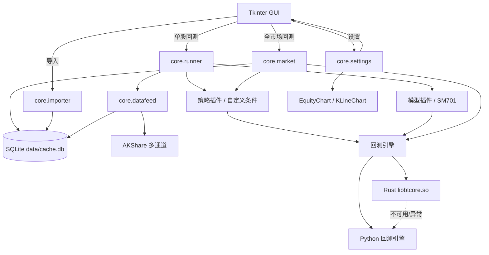

# 股票策略工坊 技术文档

| 项目 | 内容 |
|---|---|
| 产品名称 | 股票策略工坊 |
| 版本 | **0.1.0** |
| 文档版本 | 1.0 |
| 更新日期 | 2026-10-17 |
| 运行形态 | 本地桌面 GUI + 命令行 |
| 主要语言 | Python 3.10+、Rust |
| 数据源 | AKShare、本地 SQLite、内置示例行情 |
| 状态 | 本地研究/回测工具，非实盘交易系统 |

---

## 1. 文档说明

本文档描述 0.1.0 版本的总体架构、数据模型、策略/模型接口、回测执行规则、Rust 加速、
全市场逐股回测、数据导入、GUI、个性化设置、构建部署与测试方法。

相关文档：

- [模型接口](MODEL_API.md)
- [策略接口](STRATEGY_API.md)
- [本地行情导入](DATA_IMPORT.md)
- [Rust 回测加速](RUST_BACKTEST.md)

---

## 2. 系统概述

股票策略工坊是一个面向 A 股的本地量化研究与回测工具，提供：

1. 单股策略回测：均线、突破、自定义条件策略、SM701 概率模型。
2. 全市场逐股回测：从本地数据库扫描 A 股，逐股独立本金回测并汇总。
3. 可插拔策略与模型接口：自动加载 Python 插件和 JSON 自定义条件策略。
4. AKShare 多通道行情与本地 SQLite 缓存，本地数据优先。
5. CSV / SQLite 行情导入，支持拖放、自动导入、导入文件夹扫描。
6. 高对比 GUI、红涨绿跌、K 线缩放/拖拽、交易明细与导出。
7. 颜色、均线类型/周期、常用指标默认参数可配置。
8. Rust 回测撮合引擎加速，失败自动回退 Python。

非目标：实盘下单、分钟级撮合、多股票组合优化、券商接入、交易风控审批流。

---

## 3. 总体架构



### 3.1 运行进程模型

- 主进程：Tkinter 事件循环。
- 回测/导入：后台守护线程；通过 `queue.Queue` 将进度和结果回传主线程。
- 数据访问：每次线程创建独立 SQLite 连接，WAL 模式。
- Rust 共享库：通过 ctypes 在进程内调用，不启动外部子进程。

### 3.2 关键设计原则

- **本地优先**：缓存覆盖请求区间时不访问网络；全市场回测只读本地库。
- **无未来函数**：信号在 T 日收盘后产生，T+1 开盘执行。
- **接口可扩展**：策略与模型均使用注册表/插件机制，不改回测引擎。
- **故障降级**：AKShare 通道回退、Rust 回退 Python、模型/策略插件失败隔离。
- **配置与数据不入仓**：缓存、会话、设置、导出文件均不提交 Git。

---

## 4. 目录与模块

```text
stock_strategy_studio/
├── app.py                     # GUI 入口
├── cli.py                     # 命令行入口
├── gui.py                     # Tkinter UI、图表、编辑器、设置、导入、全市场窗口
├── launch.sh                  # 启动/构建脚本
├── requirements.txt
├── VERSION                    # 0.1.0
├── assets/                    # 截图与图标
├── core/
│   ├── backtest.py            # Python/Rust 回测结果组装与指标
│   ├── datafeed.py            # AKShare 通道、SQLite 缓存、本地优先
│   ├── importer.py            # CSV/SQLite 导入
│   ├── indicator_catalog.py   # 42 个条件化指标
│   ├── indicators.py          # 基础指标函数
│   ├── market.py              # 全市场逐股回测
│   ├── model_api.py           # 模型接口
│   ├── params.py              # ParamSpec/Meta
│   ├── runner.py              # 单股回测编排与导出
│   ├── rust_engine.py         # Rust ctypes 封装
│   ├── settings.py            # 个性化设置
│   ├── strategy_api.py        # 策略接口
│   └── native/libbtcore.so    # Rust 共享库
├── models/
│   ├── registry.py
│   ├── sm701_model.py
│   ├── sm701_features.py
│   └── artifacts/sm701/
├── strategies/
│   ├── builtin.py
│   ├── custom.py              # 条件策略解释器
│   ├── custom_store.py        # JSON 自定义策略持久化
│   ├── custom/                # 自定义策略文件
│   └── plugins/               # Python 策略插件
├── rust/
│   ├── backtest_core.rs
│   └── build.sh
├── docs/
├── sample_data/
├── tests/
├── data/cache.db              # 运行时行情库（Git 忽略）
└── config/                    # 会话与设置（Git 忽略）
```

---

## 5. 数据层

### 5.1 数据源与回退顺序

股票日线：

1. 东方财富 `ak.stock_zh_a_hist`
2. 腾讯 `ak.stock_zh_a_hist_tx`
3. 新浪 `ak.stock_zh_a_daily`
4. 本地缓存
5. 内置示例（仅 `sz000001`）

基准指数：

1. 新浪 `stock_zh_index_daily`
2. 东方财富 `index_zh_a_hist`
3. 本地缓存 / 内置上证指数示例

实际顺序由 `DataFeed` 控制：**本地缓存覆盖请求区间时直接返回**，否则联网补拉，
联网失败时回退缓存或示例。

### 5.2 SQLite 表结构

```sql
CREATE TABLE bars(
  symbol TEXT NOT NULL,
  adjust TEXT NOT NULL,          -- qfq / hfq / ''
  date TEXT NOT NULL,            -- YYYY-MM-DD
  open REAL, high REAL, low REAL, close REAL,
  volume REAL, amount REAL,
  source TEXT, updated_at TEXT,
  PRIMARY KEY(symbol, adjust, date)
);

CREATE TABLE index_bars(
  symbol TEXT NOT NULL,
  date TEXT NOT NULL,
  open REAL, high REAL, low REAL, close REAL,
  volume REAL, amount REAL,
  source TEXT, updated_at TEXT,
  PRIMARY KEY(symbol, date)
);
```

- 主键保证幂等 UPSERT。
- 缓存与导入使用 `(symbol, adjust, date)` 唯一约束。
- 符号统一为 `sh600000` / `sz000001` / `bj...`。
- 全市场股票池过滤规则：`sh60*`、`sh68*`、`sz00*`、`sz30*`、`bj*`。

### 5.3 数据导入

`core.importer`：

- CSV：支持中英文列名、UTF-8/GBK/GB18030、单股票文件名识别、长表多股票。
- SQLite：支持本项目 `bars` 表和常见 `daily_bars(code,date,open,high,low,close,vol)`。
- 日期：支持 `YYYY-MM-DD`、`YYYYMMDD`，SQLite 导入会标准化日期。
- 复权：文件名自动识别 qfq/hfq；数据库未标注时按窗口选择或默认 hfq。
- 批量写入：`executemany` 分块 + UPSERT。
- GUI：拖放、文件/文件夹选择、自动导入开关、导入文件夹扫描、进度与日志。

更完整的字段和操作说明见 [DATA_IMPORT.md](DATA_IMPORT.md)。

---

## 6. 指标层

### 6.1 基础指标

`core/indicators.py` 提供 SMA、EMA、RSI、ATR、MACD、KDJ、BOLL、量比、滚动高低点等基础函数，
全部基于 Pandas/NumPy 的向量化计算。

### 6.2 指标目录

`core/indicator_catalog.py` 定义 42 个可条件化指标，分组：

- 价格：收盘/开盘/最高/最低/涨跌幅/振幅/跳空
- 趋势：SMA/EMA/MACD/DMI/ADX/BIAS
- 动量：RSI/KDJ/CCI/Williams %R/ROC/Momentum/PSY
- 波动：BOLL/ATR/VWAP
- 量能：成交量/成交额/量比/OBV/MFI
- 通道：前 N 日高低、区间位置

每个指标包含：key、名称、分组、参数定义、计算函数、说明。

### 6.3 自定义条件策略

保存格式（`strategies/custom/*.json`）：

```json
{
  "slug": "custom_20261017_120000",
  "name": "我的策略",
  "entry_logic": "all",
  "exit_logic": "any",
  "entry_conditions": [
    {
      "left": {"indicator": "ma", "params": {"period": 5}},
      "op": "cross_above",
      "right": {"type": "indicator", "indicator": "ma", "params": {"period": 20}}
    }
  ],
  "exit_conditions": []
}
```

操作符：`gt/ge/lt/le/cross_above/cross_below/between/rising/falling`。

执行流程：

```text
JSON -> normalize_definition
     -> 每个条件计算 Pandas Series
     -> 比较/交叉/区间/趋势运算
     -> AND/OR 合成 entry/exit
     -> 回测引擎执行
```

信号为 T 日收盘值，T+1 开盘执行。

---

## 7. 策略与模型接口

### 7.1 策略接口

`core.strategy_api.BaseStrategy`：

```python
def generate(bars: pd.DataFrame, params: dict, context: StrategyContext) -> pd.DataFrame
```

返回以日期为索引的 DataFrame，列：`entry`、`exit`、`score`、`entry_reason`、`exit_reason`。

### 7.2 模型接口

`core.model_api.BaseModel`：

```python
def predict(bars: pd.DataFrame, params: dict, context: ModelContext) -> pd.DataFrame
```

输出列：`date`、`score`（0~1）、可选 `reason`。

关键约束：

- 严格因果，不使用未来数据。
- 模型声明的复权口径（如 SM701 的 hfq）由运行器自动加载。
- 模型文件放在 `models/artifacts/<slug>/`。
- 模型异常/缺失不影响其他策略。

### 7.3 SM701

- LightGBM 二分类，预测次日上涨概率。
- 44 维特征：动量、均线、波动、RSI、MACD、KDJ、BOLL、ATR、量能、市场环境、横截面排名。
- 使用后复权数据；单标的回测时横截面排名以 0.5 中性值近似。
- 策略阈值：买入 0.55、卖出 0.45（可在界面调整）。
- 仅作接口示例，不代表策略有效性承诺。

---

## 8. 回测引擎

### 8.1 Python 引擎

`core/backtest.py`：

- 信号 T 日收盘生成，T+1 开盘成交。
- A 股 T+1、100 股整手。
- 佣金（默认万 2.5，最低 5 元）、印花税（卖出 0.05%）、过户费 0.001%、滑点。
- 仓位比例、止损、止盈、最长持有。
- 期末清仓可选；最后一天买入不违反 T+1。
- 输出：资金曲线、成交明细、信号、指标、警告。

### 8.2 Rust 引擎

源码：`rust/backtest_core.rs`，构建为 `core/native/libbtcore.so`。

ABI 输入：

- `open[n]`、`close[n]`、`entry[n]`、`exit[n]`
- 配置：初始资金、费率、滑点、整手、仓位、止损/止盈、最长持有、期末清仓
- 输出：equity/cash/position_value/exposure 数组、成交数组、期末持仓

Rust 负责逐日撮合和资金曲线，Python 负责信号、基准、交易原因和指标汇总。
`tests/test_native.py` 对 Rust 与 Python 逐笔交易和关键指标做一致性校验。

### 8.3 指标

- 总收益、年化收益、最大回撤、Sharpe、Sortino、波动率
- 交易次数、胜率、盈亏比、平均单笔收益、暴露度
- 基准收益、超额收益

### 8.4 回退策略

- 共享库不存在/加载失败：Python。
- 原生执行错误：该股票回退 Python。
- 单股自动路径：`run_backtest_auto`。

---

## 9. 全市场逐股回测

`core.market.run_market`：

1. 按选定复权口径查询本地 A 股代码。
2. 要求每只股票在预热期 + 回测区间至少 `min_bars` 根 K 线。
3. 对每只股票独立加载行情，生成信号，调用回测引擎。
4. 每只股票使用独立初始资金（不是组合资金池）。
5. 汇总：覆盖数、成功/跳过、平均/中位收益、正收益占比、平均回撤、跑赢基准比例。
6. 结果表支持列排序；导出 `stocks.csv`、`summary.json`、`report.md`。

若模型策略需要不同复权口径（如 SM701 hfq），股票池会取两种行情的交集。

---

## 10. GUI

### 10.1 主界面

- 左侧滚动面板：行情、策略、交易参数、运行按钮。
- 右侧：指标卡、Tabs（净值与回撤、K 线与交易点、交易明细、运行日志）。
- 顶部：导入数据、全市场回测、设置、文档链接、数据目录。
- 左侧任意子控件均支持鼠标滚轮滚动。

### 10.2 K 线图

- 蜡烛图 + 成交量 + MA/EMA 均线。
- 红涨绿跌（默认）、买入/卖出标记。
- 鼠标滚轮缩放、左键拖拽平移。
- 十字光标与 OHLC/涨跌/成交量提示。
- 均线类型、周期和颜色来自设置。

### 10.3 自定义策略编辑器

- 左侧已保存策略列表。
- 右侧多条件构建器：指标、参数、操作符、右侧数值/指标。
- 入场/离场 AND/OR 逻辑。
- 另存为、删除、校验、指标库。
- 新建条件使用设置中的指标默认参数。

### 10.4 设置

三个页签：

1. 颜色与标记：上涨/下跌/买卖/策略线/基准线/回撤线/MA 颜色。
2. K 线指标：MA/EMA 类型、三条均线周期。
3. 指标默认参数：SMA/EMA/RSI/MACD/KDJ/BOLL/ATR/量比/BIAS。

设置保存到 `config/settings.json`，保存后立即应用。默认：

```json
{
  "rise_color": "#ff4d4d",
  "fall_color": "#00ff9c",
  "buy_color": "#ff4d4d",
  "sell_color": "#00ff9c",
  "ma_type": "MA",
  "ma_periods": [5, 10, 20]
}
```

实际文件还包含策略线、基准线、回撤线、MA 颜色和指标默认参数。

### 10.5 主题

- 高对比黑色主题：纯黑背景、纯白文字、亮青强调。
- 价格涨跌使用用户设置，默认红涨绿跌。
- 颜色改动会同步到 K 线、指标卡、交易明细和全市场结果。

---

## 11. 构建、运行与部署

### 11.1 依赖

```text
Python 3.10+
akshare, pandas, numpy, lightgbm, tkinterdnd2
Rust 1.70+（可选，用于回测加速）
```

### 11.2 启动

```bash
cd ~/桌面/stock_strategy_studio
./launch.sh
```

`launch.sh`：

1. 如果没有 `.venv`，创建并安装依赖。
2. 如果 Rust 共享库缺失且有 rustc，则自动构建。
3. 启动 `app.py`。

### 11.3 Rust 构建

```bash
./rust/build.sh
```

### 11.4 CLI

```bash
.venv/bin/python cli.py --list-strategies
.venv/bin/python cli.py --symbol sz000001 --strategy sm701 --offline
```

---

## 12. 测试

```bash
.venv/bin/python -m unittest discover -s tests -v
```

当前 33 项测试覆盖：

- 数据缓存与离线示例
- SM701 特征与预测
- 策略注册、自定义条件、指标库
- Python/Rust 回测一致性
- 回测 T+1/整手/费用/风控
- CSV/SQLite 导入
- 全市场逐股回测与导出
- 用户设置保存、校验与红绿颜色默认值

---

## 13. 性能

- 指标计算：Pandas/NumPy 向量化。
- 撮合：Rust 原生循环；单股回测相对 Python 约 4~5 倍加速。
- 全市场主要瓶颈：指标计算、模型推理、SQLite I/O。
- 建议：SSD、本地导入完整行情、按需设置股票数量上限进行快速验证。
- 全市场逐股回测当前为顺序执行；后续可引入多进程/分片并行。

---

## 14. 安全与隐私

- 不包含任何 API Key；密钥不写入仓库。
- `data/cache.db`、`config/last_session.json`、`config/settings.json`、`data/import/*` 均在 `.gitignore` 中。
- 导出文件位于 `exports/`，默认不纳入仓库。
- 模型文件和示例行情随项目保留，仅用于本地演示。
- 本项目不执行实盘交易，不连接券商账户。

---

## 15. 已知限制

- 全市场回测是**逐股独立**口径，不是组合资金/持仓回测。
- 日线级近似：不模拟盘中滑点、涨跌停排队、停牌、除权细节。
- SM701 在单标的场景下横截面排名使用中性值，市场环境用基准指数近似。
- 图形界面使用 Tkinter，未做多语言和移动端适配。
- Rust 预编译库与平台/CPU 相关；不支持时自动回退 Python。
- 自定义条件编辑器只支持技术指标，不支持直接嵌套模型信号。

---

## 16. 版本历史

### 0.1.0（2026-10-17）

- AKShare 单股行情、SQLite 缓存、SM701 模型示例。
- 单股回测、自定义条件策略、42 个指标。
- 高对比 GUI、K 线缩放/拖拽、交易明细分页。
- 全市场逐股回测。
- CSV/SQLite 导入与拖放、本地优先。
- Rust 回测撮合引擎与 Python 回退。
- 红涨绿跌、可配置颜色、均线类型/周期、指标默认参数。
- 技术文档、README、接口文档和 33 项测试。
